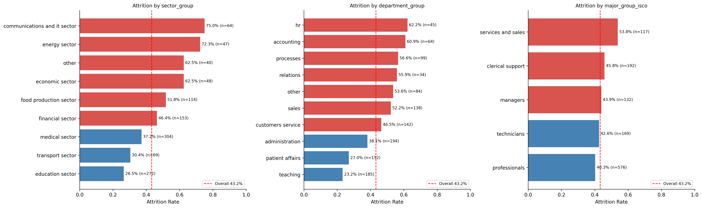
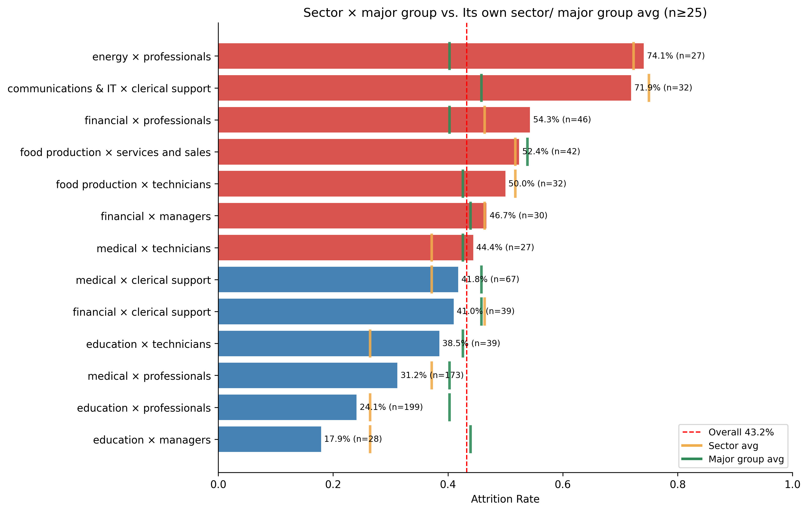
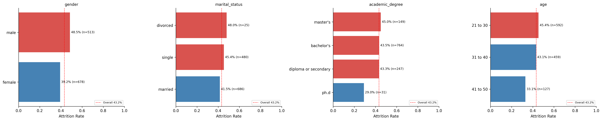
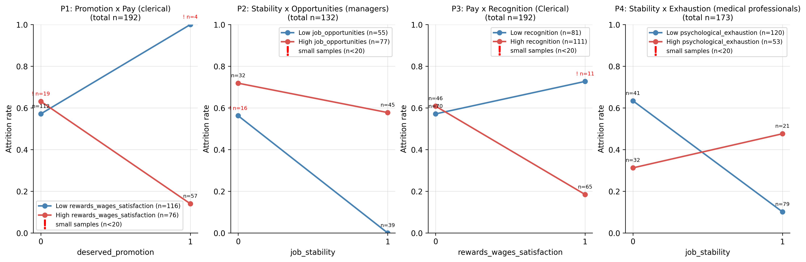

# Retention Diagnostic for Saudi Private Sector (2026)

## Table of Contents
- [Judgement and Position](#judgement-and-position)
- [Data Scope](#data-scope)
- [1. Sector Sets the Baseline, Major Group Determines the Driver](#1-sector-sets-the-baseline-major-group-determines-the-driver)
- [2. Perceived External Opportunities Are the Strongest Driver, Countering the Pull and Eliminating the Push](#2-perceived-external-opportunities-are-the-strongest-driver-countering-the-pull-and-eliminating-the-push)
- [3. Single-Point Interventions May Reverse Direction, Requiring Combined Retention Actions](#3-single-point-interventions-may-reverse-direction-requiring-combined-retention-actions)
- [4. Action List](#4-action-list)
- [5. Boundary Statement](#5-boundary-statement)
- [6. Future Research Suggestions](#6-future-research-suggestions)
- [References](#references)
- [Appendix A: ISCO-08 Mapping Logic](#appendix-a-isco-08-mapping-logic)
- [Appendix B: Demographic Baseline](#appendix-b-demographic-baseline)
- [Appendix C: Interaction Tests](#appendix-c-interaction-tests)
- [Appendix D: Model Performance](#appendix-d-model-performance)
- [Appendix E: Code & Data](#appendix-e-code--data)

---

## Judgement and Position
Retention resources should be allocated based on risk stratification by sector and occupation, as well as defense against external opportunities. Demographic characteristics and global pay coefficients are insufficient to support stratification in this data. Therefore, they should not be used as allocation bases. This report identifies stable stratification dimensions within a full industry sample. Readers can benchmark these findings against their own organizations. This report is not a customized diagnostic for a specific organization. It does not constitute policy advice. Specific actions require further refinement combined with the organization's pay, promotion, and turnover data.

## Data Scope
Saudi private sector employees. N=1,191. Cross-sectional, retrospective self-report. Past attrition rate is **43.2%** (515/1,191). For employees with past attrition, the reference is their previous employer. For those without, the reference is their current job. All attrition rates in the report refer to past attrition rate. All associations are retrospective and non-causal. Data were collected from June to November 2023. The report was finalized in 2026. Occupational classification is based on the `JobTitle` field and mapped to ISCO-08 major groups. See [Appendix A](#appendix-a-isco-08-mapping-logic) for the full mapping rules.

---

## 1. Sector Sets the Baseline, Major Group Determines the Driver

### 1.1 Wide sector gap (over 48 percentage points), sector baseline should be set first
Education sector attrition rate is about **27%** (n=272). Communications and IT reaches **75%** (n=64). The gap is **48 percentage points** (Figure 1). This is about 5 times the gender gap (9.3pp). The gender gap is only used for magnitude reference. See [Appendix B](#appendix-b-demographic-baseline) for demographic data. Other demographic factors like marital status, education, and age show no consistent patterns. PhD shows a lower attrition rate but n=31. It is not used as an allocation basis.

### 1.2 Major group shows the driver pattern
Among the 13 sector × major_group combinations with sample size >25 (Figure 2), only **4 are driven by major group**. These are education×technicians, financial×clerical support, medical×clerical support, and medical×technicians. These 4 fall in the mid-low range of 38.5% to 44.4%. The other 9 are driven by sector. Sector remains the primary explanation dimension.

However, when using major group as a stratum to explore attrition drivers, the patterns differ (Table 1).

*Note. Values are bivariate correlation coefficients. Ranking reflects association strength, not independent effect size in multivariate models.*

| Major Group | n | 1st Correlate | 2nd Correlate | 3rd Correlate |
| :--- | :--- | :--- | :--- | :--- |
| Professionals | 576 | **Perceived External Opportunities** (`job_opportunities`) (0.333) | Job Satisfaction (`job_satisfaction`) (−0.238) | **Perceived Job Stability** (`job_stability`) (−0.237) |
| Technicians | 169 | **Perceived External Opportunities** (`job_opportunities`) (0.429) | Job Engagement (`job_engagement`) (−0.307) | **Perceived Job Stability** (`job_stability`) (−0.292) |
| Managers | 132 | **Perceived External Opportunities** (`job_opportunities`) (0.470) | **Perceived Work-Life Balance** (`work_life_balance`) (−0.366) | **Perceived Job Stability** (`job_stability`) (−0.346) |
| Clerical support | 192 | **Perceived Promotion Fairness** (`deserved_promotion`) (−0.358) | **Perceived External Opportunities** (`job_opportunities`) (0.324) | **Perceived Pay Satisfaction** (`rewards_wages_satisfaction`) (−0.317) |
| Services and sales | 117 | **Perceived External Opportunities** (`job_opportunities`) (0.291) | Physical Stress (`physical_stress`) (0.209) | **Perceived Work-Life Balance** (`work_life_balance`) (−0.180) |

*Note. Total n for the five groups is 1,186. The remaining 5 are plant and machine operators. Sample too small for statistics.*

**1.2.1** Perceived External Opportunities are the primary correlate for 4 of the 5 groups. Managers are highest at **0.470**. Services and sales are lowest at **0.291**. Clerical support is the only exception. Perceived Promotion Fairness (**−0.358**) ranks first. 

A possible explanation. Clerical support roles at lower organizational levels are routine and support-oriented. This relationship is examined in a high power-distance cultural context (Hofstede, 2001; Taras et al., 2010). Internal promotion is the only institutionalized upward mobility channel for clerical roles. Previous research suggests that procedural fairness in promotion plays a key role in turnover decisions (Liao & Rupp, 2005).

**1.2.2** Services and sales has the lowest primary correlate at only **0.291**. Physical Stress (**0.209**) is second. Psychological and satisfaction variables did not enter the top two.

---

## 2. Perceived External Opportunities Are the Strongest Driver, Countering the Pull and Eliminating the Push
Retention strategy should focus on countering external pull and eliminating internal push.

### 2.1 Effect structure
Perceived External Opportunities (`job_opportunities`) show an advantage across models built on different assumptions. The matrix below shows core variables across four methods.

| Variable | EDA r | Logit OR | RF Permutation Imp | CART Used |
| :--- | :--- | :--- | :--- | :--- |
| **Perceived External Opportunities** (`job_opportunities`) | **0.349** | **5.79** | **0.122 ± 0.002** | Yes |
| Years of Experience (`years_experience_mid`) | 0.137 | 1.11 | 0.053 | Yes |
| Emotional Commitment (`emotional_commitment`) | -0.231 | 0.65 | 0.014 | Yes |
| **Perceived Job Stability** (`job_stability`) | -0.254 | 0.54 | 0.013 | Yes |

*Note. See [Appendix D](#appendix-d-model-performance) for the full permutation importance matrix. Units differ across methods.*

The Logit OR of **5.79** for Perceived External Opportunities means its odds ratio is over 5 times that of the second variable (OR=1.11). When employees perceive sufficient external opportunities, internal emotional commitment (OR=0.65) and perceived job stability (OR=0.54) can hardly provide a defense.

### 2.2 Extreme profiles and exceptions
*Note. Profiles are based on the CART tree. Terminal node sample sizes vary.*

*   **Highest risk profile (85.5%, n=173)**. Higher Perceived External Opportunities, work experience >5 years, lower Perceived Job Stability.
*   **Lowest risk profile (6.0%, n=215)**. Lower Perceived External Opportunities, received deserved promotion, no health issues forcing turnover.

*   **Low opportunity group, high attrition (56.4%, n=94)**. Did not receive deserved promotion, low job engagement.
*   **High opportunity group, low attrition (24.6%, n=69)**. Work experience ≤5 years, high emotional commitment.

**Core insights.**
1.  **Stability cannot counter strong external pull**. For employees with >5 years of experience, if they perceive high external opportunities, attrition rate is still **58.6%** even with high perceived job stability. Soft benefits alone are not enough.
2.  **External pull and internal push jointly determine turnover**. When external opportunities are low, internal unfair promotion and low engagement still push people out. When external opportunities are high, internal emotional commitment protects junior employees.

### 2.3 Management Recommendations

**2.3.1 Locate the highest risk group**
For the group with high Perceived External Opportunities and >5 years of experience, low stability is associated with **85.5%** attrition. High stability still corresponds to **58.6%** attrition. This 27 percentage point gap suggests stability has a buffering value. Organizations should not abandon providing stability. However, over half of employees still leave even with high stability. Empirical research based on a non-Saudi restaurant-manager sample suggests internal promotees have lower turnover risk (Hardy et al., 2025). Increasing the visibility of internal promotion channels can offset external pull.

**2.3.2 Identify low risk blind spots**
Even when external opportunities are low, if internal promotion is unfair and engagement is low, attrition reaches **56.4%**, higher than the full sample average of 43.2%.
*   **Clerical support**. Focus on transparency and compliance of promotion procedures.
*   **Technicians**. Focus on delegating technical decision-making power.
*   **Services and sales**. Focus on optimizing scheduling to reduce physical stress.
*   **Managers**. Provide high-level opportunities while intervening in workload (WLB).

**2.3.3 Consolidate the lowest risk group**
*   **Keep the low risk group**. Guarantee basic health benefits and procedural fairness for all.
*   **Protect the low risk group in high risk zones**. For junior employees (≤5 years), strengthen mentoring and corporate culture to use emotional bonds against external offers.

---

## 3. Single-Point Interventions May Reverse Direction, Requiring Combined Retention Actions
*Warning. Post-hoc tests. Small sample sizes in some cells. Need qualitative interviews for validation.*

**3.1 High stability may become a turnover accelerator under exhaustion**
**Counterintuitive data.** When employees perceive high psychological exhaustion, higher Perceived Job Stability is associated with higher attrition. Interaction term **OR_int=6.55**, p_fdr=0.001.
**Management insight.** The loss priority principle of Conservation of Resources theory (Hobfoll et al., 2018). Exhausted employees lack the capacity to buffer through perceived stability. High stability raises the cost of leaving. They would rather bear the cost of giving up stability to stop further resource loss. **Reduce workload first, then discuss retention.**

**3.2 Under low recognition, Pay Satisfaction may weaken retention protection**
**Counterintuitive data.** Under high recognition, Perceived Pay Satisfaction is associated with lower attrition. Under low recognition, protection weakens and the point estimate reverses. Interaction **OR_int=0.073**, p_fdr=0.004.
**Management insight.** Organizational justice research (Colquitt et al., 2001). When the relational level is damaged, even when pay is rated satisfactory, it is difficult to rebuild trust. **Before recognition issues are resolved, pay satisfaction improvements should not be the primary retention lever.**

**3.3 Exploratory outlook (Quasi-separation)**
Two extreme cells found. Logit model fails to converge due to 0% or 100% attrition rates.
*   **Clerical promotion without pay raise (n=4, 100% attrition)**. Promotion without substantive pay support accelerates turnover due to unmet expectations.
*   **Managers external fragility**. When managers perceive no external opportunities, high stability group has 0% attrition. Under high external opportunities, low stability managers show 71.9% attrition (n=32), while high stability managers still show 57.8% (n=45). External pull overrides stability.

---

## 4. Action List

| Priority | Core Action Instruction | Target Group | Core KPI |
| :--- | :--- | :--- | :--- |
| **P0** | **Stop using demographic labels** to allocate retention resources. | All | Cross-tabulations show no significant differences. |
| **P0** | **Set sector baselines**, use Perceived External Opportunities as the root node for screening. | All | Sector baseline table. High opportunity list. |
| **P0** | 1-on-1 stay interviews for high opportunity + experience >5 years + low stability. | Highest risk CART group (85.5%) | Review coverage rate. Attrition rate change. |
| **P1** | **Clerical support**. Review promotion compliance. Prioritize recognition repair. | Clerical support (low opportunity) | Promotion fairness score, recognition score. |
| **P1** | **Technicians**. Establish technical committees. Delegate decision power. | Technicians (low opportunity) | Job engagement score improvement. |
| **P1** | **Services and sales**. Optimize scheduling and reduce workload. | Services and sales | Physical stress decrease, scheduling compliance. |
| **P1** | **Managers**. Develop succession plans. Intervene in workload. | Managers | Succession plan coverage rate, WLB score. |
| **P1** | **Qualitative interviews** for the 2 unverified exploratory analyses. | Clerical/Managers small samples | Analysis report. |
| **P2** | **Intervention after back-testing**. Reduce workload for medical staff. Recognition repair before pay/satisfaction adjustments for clerical staff. | Medical, Clerical | Back-test pass rate, exhaustion score decrease. |
| **P2** | Implement mentoring and emotional culture building for junior employees (≤5 years). | Junior employees | Attrition rate, emotional commitment score. |
| **P2** | **Establish a quarterly early warning system** by sector × occupation × external opportunities. | HR analytics team | Early warning coverage rate. |

---

## 5. Boundary Statement
This report is an exploratory diagnostic. All results are associative descriptions and do not constitute causal inference.

*   **5.1 No causal inference**. Drivers and attrition outcomes are measured simultaneously. Temporal order cannot be confirmed. Results may be affected by recall bias and unobserved confounding.
*   **5.2 Not for individual high-stakes decisions**. Model AUC is 0.78 to 0.82. Suitable for group-level risk sorting, not individual automated decisions.
*   **5.3 No misreading of statistical significance**. Adjusted Logit non-significance should not be read as no effect. EDA significance does not justify global rollout.
*   **5.4 Exploratory findings cannot be scaled**. Section 3 has quasi-separation. Conclusions are only hypotheses for qualitative interviews. Theoretical mechanisms (COR, organizational justice) should be viewed as competitive hypotheses to be tested.
*   **5.5 No direct extrapolation**. Sample is from the Saudi private sector. These results cannot be directly extrapolated to public sectors or other countries.
*   **5.6 Does not replace internal diagnosis**. Specific actions must be calibrated with the organization's internal data. Demographic characteristics should not be used for resource allocation.

---

## 6. Future Research Suggestions

**6.1 Introduce Performance Dimension**. The current model treats attrition as a homogeneous outcome. Include performance ratings to focus on the differential impact of external opportunity perception on high vs. low performers. Identify high-performer attrition.

**6.2 Introduce Leader-Member Exchange (LMX) Dimension**. Clerical support is sensitive to recognition. Use the LMX scale to measure relationship quality with direct supervisors. Lack of recognition is often a frontline manager capability issue. This helps refine interventions to manager training.

**6.3 Establish Longitudinal Tracking Cohort**. Use quarterly pulse surveys to track trends in external opportunity perception, exhaustion, and stability. Use longitudinal panel data to solve reverse causality.

---

## References

1. Colquitt, J. A., Conlon, D. E., Wesson, M. J., Porter, C. O. L. H., & Ng, K. Y. (2001). Justice at the millennium: A meta-analytic review of 25 years of organizational justice research. *Journal of Applied Psychology, 86*(3), 425–445.
2. Hardy, J. H., III, Thiel, C. E., Gibson, C., Klotz, A. C., & Barsa, A. (2025). After shocks: The effects of internal sourcing on voluntary turnover. *Journal of Applied Psychology, 110*(9), 1283–1296.
3. Hobfoll, S. E., Halbesleben, J., Neveu, J.-P., & Westman, M. (2018). Conservation of resources in the organizational context: The reality of resources and their consequences. *Annual Review of Organizational Psychology and Organizational Behavior, 5*(1), 103–128.
4. Hofstede, G. (2001). *Culture's consequences: Comparing values, behaviors, institutions and organizations across nations* (2nd ed.). Sage Publications.
5. Liao, H., & Rupp, D. E. (2005). The impact of justice on job performance and withdrawal: Examining the mediating role of trust and the moderating role of power distance. *Journal of Applied Psychology, 90*(3), 520–532.
6. Taras, V., Kirkman, B. L., & Steel, P. (2010). Examining the impact of culture's consequences: A three-decade, multilevel, meta-analytic review of Hofstede's cultural value dimensions. *Journal of Applied Psychology, 95*(3), 405–439.

---

## Appendix A: ISCO-08 Mapping Logic
*Note. This table maps all 305 unique raw job titles to the 9 Major Groups used in this report. The 2-digit ISCO code determines the specific sub-category. Titles in the final column are Medium-Conditional, meaning they were mapped based on secondary fields. (Dept) indicates `department_raw`, and (Sector) indicates `sector_raw`.*

| ISCO Code | Major Group | High | Medium | Medium-Conditional (Title + Dept/Sector) |
| :--- | :--- | :--- | :--- | :--- |
| **12** | Managers | administrative manager, financial manager, hr director, operations manager, production manager, sales manager | relations manager, reports manager, head of treasury, quality manager, after sales service manager | project manager (Sector: financial/media/engineering) |
| **13** | Managers | - | operation and maintenance manager (acting), cybersecurity director | project manager (Sector: others) |
| **21** | Professionals | chemical engineer, civil engineer, electrical engineer, mechanical engineer, project engineer, process engineer, engineer, graphic designer | - | - |
| **22** | Professionals | doctor, pharmacist, nutrition specialist, dentist, nurse | - | - |
| **23** | Professionals | teacher, lecturer | - | trainer (Sector: education) |
| **24** | Professionals | accountant, financial analyst, hr specialist, hiring specialist, marketing specialist, consultant | business partners, quality specialist, relations specialist, relationship specialist, relationships specialist | trainer (Sector: transport), sales executive (Sector: communications/IT) |
| **25** | Professionals | application information technology, information technology, it specialist | application specialist | - |
| **26** | Professionals | lawyer, social worker | - | - |
| **31** | Technicians | production supervisor | quality controller, quality specialist | lab specialist (Sector: food production), operations supervisor (Sector: energy/food) |
| **32** | Technicians | medical technician, radiographer | - | lab specialist (Sector: medical), operations supervisor (Sector: medical), supervisor (Dept: medical/processes) |
| **33** | Technicians | - | insurance officer, manager assistant (incl. 'manager as'), operations specialist, purchase specialist | operations supervisor (Sector: others), sales executive (Sector: others), coordinator (Dept: others), supervisor (Dept: others) |
| **35** | Technicians | technical support | - | operations supervisor (Sector: communications/IT), supervisor (Dept: technical support) |
| **41** | Clerical Support | data entry operator, secretary, secretariat | scribe | - |
| **42** | Clerical Support | customer services representative, receptionist, administrative assistant | passenger services assistant | - |
| **43** | Clerical Support | - | banking operations, treasury agent, warehouse officer | - |
| **44** | Clerical Support | - | - | supervisor (Dept: hr), coordinator (Dept: hr) |
| **52** | Services and Sales | salesman, sales representative, sales worker | - | supervisor (Dept: sales) |
| **54** | Services and Sales | - | security and safety specialist | supervisor (Dept: safety & security) |
| **83** | Machine Operators | driver | - | - |

---

## Appendix B: Demographic Baseline
*Note. Graph revealed no consistent patterns in attrition rates across gender, age, marital status, or education. The Ph.D. group (n=31) is excluded from resource allocation decisions due to the small sample size and low business ROI.*

---

## Appendix C: Interaction Tests
The following 4 simple slopes charts illustrate the interactions.

Formal interaction tests were conducted. Two models failed to converge due to extreme data distribution (0% or 100% attrition). This caused quasi-separation.

| Subgroup | Driver | Buffer (Moderator) | n | OR_int | p_fdr | Status |
| :--- | :--- | :--- | :--- | :--- | :--- | :--- |
| **Medical Professionals** | Job Stability | Psychological Exhaustion | 173 | 6.55 | 0.001 | **Significant** |
| **Clerical Support** | Pay Satisfaction | Recognition | 192 | 0.073 | 0.004 | **Significant** |
| **Clerical Support** | Deserved Promotion | Pay Satisfaction | 192 | N/A | 1.000 | **Quasi separation** |
| **Managers** | Job Stability | Job Opportunities | 132 | N/A | 1.000 | **Quasi separation** |

*Note. n is sample size. OR_int and p_fdr are from Logit tests. Top two rows passed with sign reversal. Bottom two rows failed due to 0% or 100% attrition. They are descriptive signals only.*

---

## Appendix D: Model Performance

**1. Four-Source Validation Matrix**
*Variables are assigned to Tier 1/2 only if they pass the rigorous multi-source tests. Tier 4 variables (e.g., psychological_exhaustion) failed global significance but were retained for subgroup interaction analysis in the main text.*

| Feature (Business Concept) | Raw Variable | Evidence Tier | EDA r | EDA Sig | Logit Sig | RF Sig | CART Used | RF Imp |
| :--- | :--- | :--- | :--- | :--- | :--- | :--- | :--- | :--- |
| **Perceived External Opportunities** | `job_opportunities` | **Tier 1 (Core)** | 0.3493 | Yes | Yes | Yes | Yes | 0.1224 |
| Years of Experience | `years_experience_mid` | **Tier 1 (Core)** | 0.1372 | Yes | Yes | Yes | Yes | 0.0530 |
| Emotional Commitment | `emotional_commitment` | **Tier 1 (Core)** | -0.2312 | Yes | Yes | Yes | Yes | 0.0139 |
| **Perceived Job Stability** | `job_stability` | **Tier 1 (Core)** | -0.2536 | Yes | Yes | Yes | Yes | 0.0128 |
| **Perceived Promotion Fairness** | `deserved_promotion` | **Tier 2 (Strong)** | -0.2389 | Yes | Yes | No | Yes | 0.0075 |
| Job Engagement | `job_engagement` | **Tier 2 (Strong)** | -0.1582 | Yes | Yes | No | Yes | 0.0047 |
| Perceived Organizational Support | `job_support` | Tier 4 (Weak) | -0.1822 | Yes | No | No | No | 0.0050 |
| Psychological Exhaustion | `psychological_exhaustion` | Tier 4 (Weak) | 0.1537 | Yes | No | No | No | 0.0049 |
| **Perceived Work-Life Balance** | `work_life_balance` | Tier 4 (Weak) | -0.1573 | Yes | No | No | No | 0.0039 |
| Age | `age_mid` | Tier 4 (Weak) | -0.0571 | No | Yes | No | No | 0.0024 |
| **Perceived Recognition** | `recognition` | Tier 4 (Weak) | -0.1703 | Yes | No | No | No | 0.0011 |
| Health Issues | `health_issues` | Tier 4 (Weak) | 0.0761 | No | No | No | Yes | 0.0007 |
| **Perceived Pay Satisfaction** | `rewards_wages_satisfaction` | Tier 4 (Weak) | -0.2279 | Yes | No | No | No | 0.0004 |
| Unpaid Overtime | `unpaid_overtime` | Tier 4 (Weak) | 0.1105 | Yes | No | No | No | 0.0004 |
| Physical Stress | `physical_stress` | Tier 4 (Weak) | 0.1013 | Yes | No | No | No | 0.0003 |

**2. Model Performance & Algorithmic Cut-off Note**
*   **ROC-AUC (5-fold CV)**. Logistic Regression = **0.784**. Random Forest = **0.821**. Baseline = 0.500. Models demonstrate strong discriminative power for risk stratification. They are not for individual automated decision-making.
*   **Note on `years_experience_mid` (Cut-off = 5.0)**. The CART algorithm split at `5.0`. This is the mathematical midpoint between the bin centers (2.5 and 7.5). The calculation is `(2.5 + 7.5) / 2 = 5.0`. It perfectly aligns with the survey's business boundary of "Less than 5 years" versus "5 years and above".

---

## Appendix E: Code & Data
The full data cleaning pipeline, exploratory analysis, and predictive modeling scripts are available in this repository.

**(a) Repository Structure**
* [`01Clean_data.ipynb`](./01Clean_data.ipynb). Data cleaning, logic checks, ISCO-08 occupational mapping.
* [`02EDA.ipynb`](./02EDA.ipynb). Demographic baselines, Spearman correlations, and Buffer Scan.
* [`03Modeling.ipynb`](./03Modeling.ipynb). Logistic Regression, CART, Random Forest, ROC-AUC, and FDR corrections.

**(b) Data Availability**
* The anonymized dataset is stored in the `data/` folder.
* A full 305-row mapping table for raw job titles is provided as [`mapping_job_title.csv`](./data/mapping_job_title.csv).
